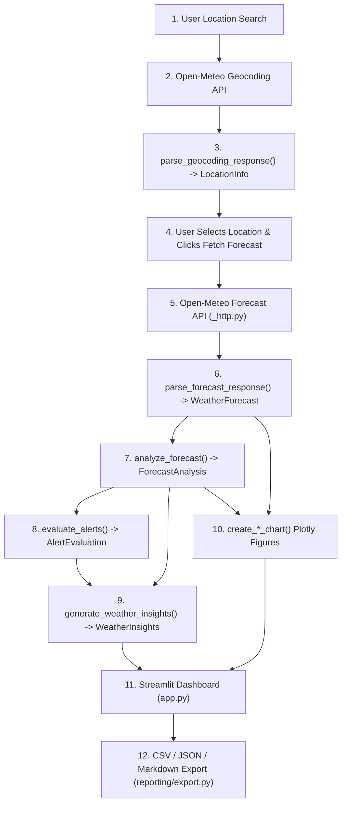
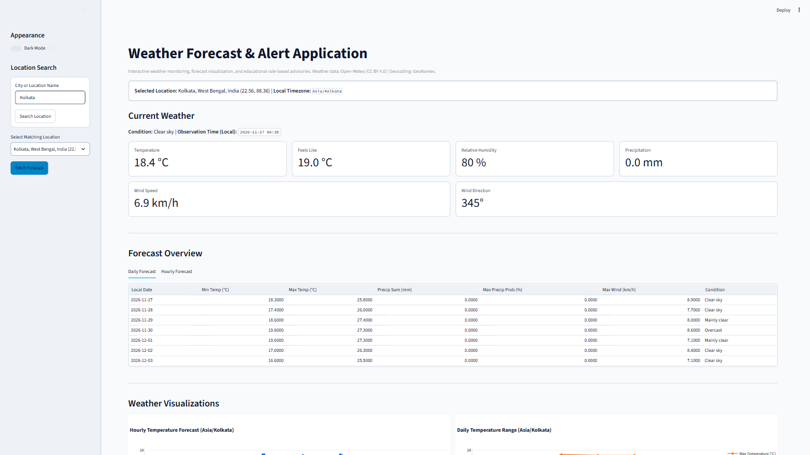
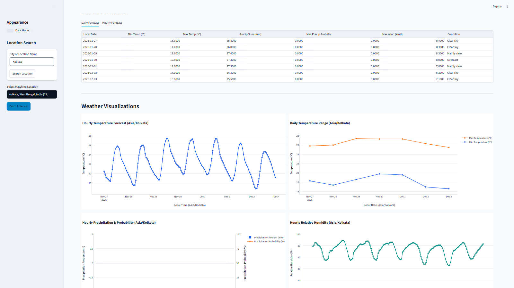
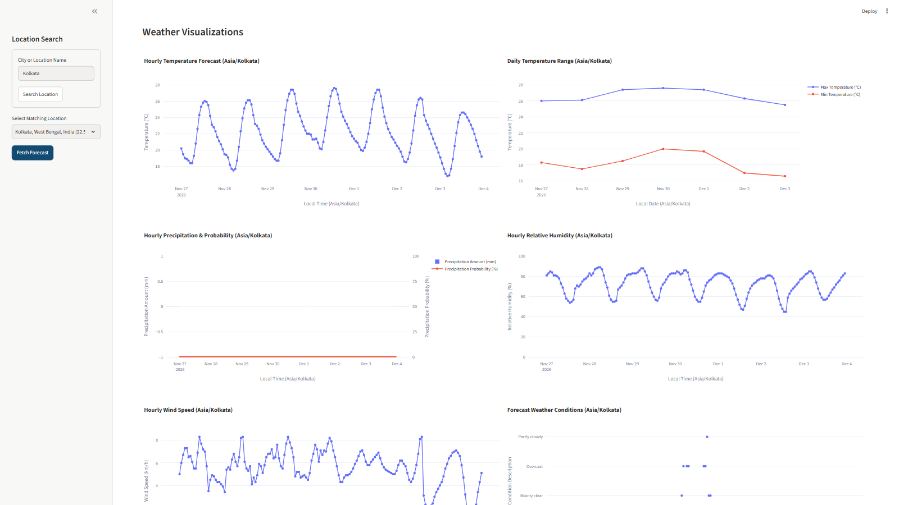
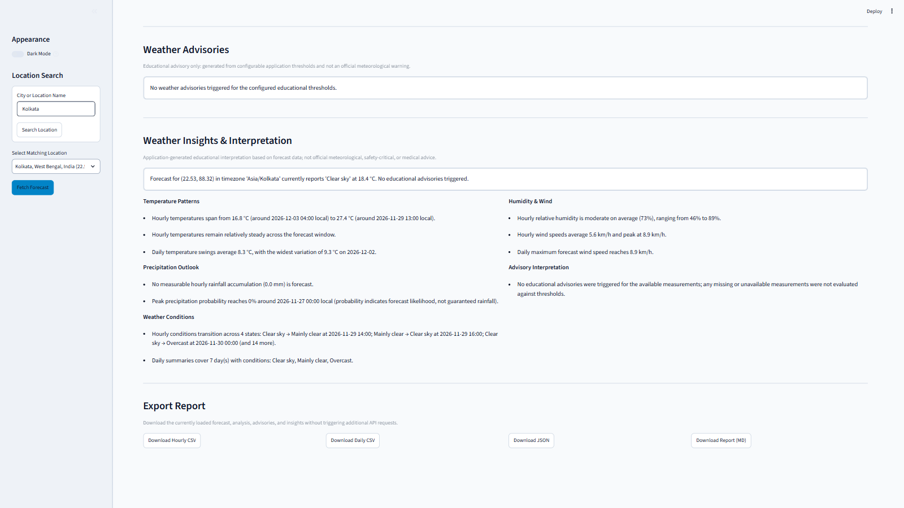

# Weather Forecast & Alert Application v2

-3776AB?logo=python&logoColor=white)


A modular Python weather forecasting, analysis, advisory, visualization, and reporting application built with Open-Meteo APIs, Plotly, and Streamlit.

> **Educational Advisory Disclaimer:** Alerts and interpretations generated by this application are deterministic, rule-based educational summaries derived from configurable thresholds. They must not be treated as official meteorological warnings, emergency alerts, or safety-critical advice.

---

## Table of Contents

- [1. Project Overview](#1-project-overview)
- [2. Project Objectives](#2-project-objectives)
- [3. Key Features](#3-key-features)
- [4. Technology Stack](#4-technology-stack)
- [5. System Architecture](#5-system-architecture)
- [6. Data Workflow](#6-data-workflow)
- [7. Forecast Analysis and Weather Insights](#7-forecast-analysis-and-weather-insights)
- [8. Weather Alert Logic](#8-weather-alert-logic)
- [9. Weather Data Provider and Data Source](#9-weather-data-provider-and-data-source)
- [10. Dataset and Data Handling](#10-dataset-and-data-handling)
- [11. Streamlit Dashboard](#11-streamlit-dashboard)
- [12. Dashboard Screenshots](#12-dashboard-screenshots)
- [13. Report Generation and Export](#13-report-generation-and-export)
- [14. Project Directory Structure](#14-project-directory-structure)
- [15. Environment Setup](#15-environment-setup)
- [16. Dependency Installation](#16-dependency-installation)
- [17. Application Execution](#17-application-execution)
- [18. Running Tests](#18-running-tests)
- [19. Example Application Workflow](#19-example-application-workflow)
- [20. Privacy and Ethical Safeguards](#20-privacy-and-ethical-safeguards)
- [21. Limitations](#21-limitations)
- [22. Future Improvements](#22-future-improvements)
- [23. Contribution Guidelines](#23-contribution-guidelines)
- [24. License](#24-license)
- [25. Project Documentation and References](#25-project-documentation-and-references)
- [26. Author and Acknowledgements](#26-author-and-acknowledgements)

---

## 1. Project Overview

**Weather Forecast & Alert Application v2** retrieves live weather forecasts and geocoded locations from Open-Meteo, validates and parses nested JSON payloads into immutable Python dataclasses, computes descriptive forecast statistics, evaluates configurable educational alert thresholds, generates plain-language weather insights, renders interactive Plotly charts inside a Streamlit dashboard, and exports structured reports in CSV, JSON, and Markdown formats.

### Why This Project Was Developed
Raw meteorological API payloads are nested JSON objects containing parallel arrays, numeric WMO weather codes, and optional null measurements that are difficult for non-specialists to interpret directly. This project transforms raw API responses into validated domain models, visual trends, transparent threshold advisories, and portable reports.

### Relationship to the Original 2025 Project
Version 2 is the enhanced, independently maintained successor to the original 2025 repository:

- **Original 2025 Repository:** [Weather-Forecast-Alert-Monitoring-System](https://github.com/AkashDas-AI/Weather-Forecast-Alert-Monitoring-System)

While the 2025 edition centered on synthetic environmental data simulation and local SQLite pipelines, Version 2 introduces live Open-Meteo Forecast API and Open-Meteo Geocoding API integration, immutable `frozen=True` Python 3.11 dataclasses, strict schema validation, naive local timezone preservation, missing-value (`None`) safety without zero substitution, interactive Plotly charts, explicit-fetch Streamlit state management, deterministic weather insights, path-safe CSV/JSON/Markdown exports, and an offline `pytest` suite. Both repositories maintain independent Git histories.

---

## 2. Project Objectives

- Retrieve live current, hourly, and 7-day daily forecasts from a public weather API.
- Resolve city and place-name queries into geographic coordinates via geocoding.
- Parse and validate nested API JSON into typed, immutable domain models.
- Compute descriptive forecast metrics without silently substituting missing values with zero.
- Evaluate configurable, educational weather alert thresholds with duplicate prevention.
- Present interactive, Streamlit-independent Plotly visualizations.
- Generate deterministic, beginner-friendly weather insights and interpretations.
- Export reproducible CSV, JSON, and Markdown reports from both the dashboard and CLI.
- Maintain offline testability and clean modular separation across all packages.

---

## 3. Key Features

- **Open-Meteo Forecast & Geocoding Integration:** `WeatherAPIClient` and `GeocodingClient` with coordinate, horizon, and query validation plus timeout/connection/HTTP exception translation.
- **Immutable Domain Models:** `LocationInfo`, `ForecastMetadata`, `CurrentWeather`, `HourlyForecast`, `DailyForecast`, and `WeatherForecast` (`frozen=True` dataclasses).
- **Descriptive Forecast Analysis:** Temperature extremes and averages, humidity summaries, precipitation totals/probabilities (kept separate in `mm` and `%`), wind speeds, and WMO weather-code descriptions.
- **Configurable Educational Alert Engine:** Rule-based evaluation across current, hourly, and daily scopes with deterministic `alert_id` deduplication.
- **Six Interactive Plotly Charts:** Hourly temperature, daily min/max temperature, dual-axis precipitation amount and probability, relative humidity, wind speed, and weather conditions timeline.
- **Explicit-Fetch Streamlit Dashboard:** Search, location selection, and explicit **Fetch Forecast** triggers managed via `st.session_state` so widget reruns and downloads never trigger extra API requests.
- **Weather Insights & Interpretation:** Deterministic, rule-based plain-language summaries covering temperature trends, daily ranges, precipitation outlook, humidity, wind, condition transitions, and advisory interpretation.
- **Report Generation (Dashboard & CLI):** Downloadable and CLI-exportable CSV (hourly and daily), JSON, and Markdown reports with filename sanitization and path-traversal protection.
- **Offline Automated Test Suite:** Mocked HTTP/service tests, Streamlit `AppTest` UI state tests, and CLI tests.

---

## 4. Technology Stack

| Technology | Purpose | Actual Usage in Repository |
| :--- | :--- | :--- |
| **Python 3.11+** | Core runtime (`>=3.11` declared, `3.11.0` verified) | Application logic, frozen dataclasses, type hints |
| **Requests (`>=2.31.0`)** | HTTP client | `src/weather_app/api/_http.py` GET requests with timeout handling |
| **Plotly (`>=5.18.0`)** | Interactive data visualization | Six chart builders in `src/weather_app/visualization/charts.py` |
| **Streamlit (`>=1.32.0`)** | Interactive web dashboard | `app.py` UI, `st.session_state` workflow, `st.download_button` exports |
| **Pytest (`>=8.0.0`)** | Automated testing | Offline unit, `AppTest`, and CLI tests in `tests/` |
| **GitHub Actions** | Continuous integration | `.github/workflows/tests.yml` running `pytest` on Python 3.11 |

---

## 5. System Architecture

The application uses a layered `src/weather_app/` package layout separating external I/O, parsing, domain models, analysis, alerts, visualization, reporting, and presentation entry points. Architecture diagrams are not yet stored as image files in `images/diagrams/` (`.gitkeep` placeholder is present).

| Module / File | Responsibility |
| :--- | :--- |
| `src/weather_app/core/config.py` | Centralized endpoints, default units, forecast horizon, and `APIConfig` |
| `src/weather_app/core/exceptions.py` | Custom `WeatherAppError` hierarchy including `ReportExportError` |
| `src/weather_app/api/` | `WeatherAPIClient`, `GeocodingClient`, and shared `_http.py` error translator |
| `src/weather_app/models/weather.py` | Immutable weather and location dataclasses |
| `src/weather_app/services/weather_service.py` | Strict JSON parsing and validation (`parse_forecast_response`, `parse_geocoding_response`) |
| `src/weather_app/services/forecast_service.py` | Orchestration (`search_locations`, `get_weather_dashboard_data`, `DashboardWeatherBundle`) |
| `src/weather_app/analysis/forecast_analysis.py` | Descriptive statistics (`analyze_forecast`) and `WMO_WEATHER_CODES` mapping |
| `src/weather_app/analysis/insights.py` | Rule-based plain-language interpretation (`generate_weather_insights`) |
| `src/weather_app/alerts/` | `AlertThresholds` validation and `evaluate_alerts()` engine |
| `src/weather_app/visualization/charts.py` | Six Streamlit-independent Plotly figure builders |
| `src/weather_app/reporting/export.py` | CSV, JSON, and Markdown exporters plus safe filename/path utilities |
| `src/weather_app/utils/date_time.py` | Naive local ISO-8601 `parse_iso_datetime()` and `parse_iso_date()` |
| `src/weather_app/storage/database.py` | Phase 2 SQLite persistence scaffold (not active in current runtime) |
| `app.py` | Interactive Streamlit dashboard entry point |
| `scripts/generate_report.py` | Standalone CLI report generator |

---

## 6. Data Workflow



1. **Location Search:** User enters a city name in `app.py` or passes `--city` to `scripts/generate_report.py`.
2. **Geocoding:** `GeocodingClient.search_location()` queries the Open-Meteo Geocoding API.
3. **Forecast Request & HTTP Handling:** Upon explicit **Fetch Forecast** click (or CLI run), `WeatherAPIClient.fetch_forecast()` sends a GET request via `_http.py` with a 10-second timeout and custom exception mapping.
4. **JSON Parsing & Domain Models:** `parse_forecast_response()` validates required keys, coordinate bounds, array lengths, and ISO-8601 local timestamps into `WeatherForecast`.
5. **Forecast Analysis:** `analyze_forecast()` computes descriptive temperature, humidity, precipitation, and wind metrics over non-null values.
6. **Alert Evaluation & Insights:** `evaluate_alerts()` checks thresholds and `generate_weather_insights()` builds educational explanations.
7. **Visualization & Dashboard Presentation:** `DashboardWeatherBundle` is cached in `st.session_state["weather_bundle"]` and rendered across metrics, tables, six Plotly charts, advisories, and insights.
8. **Report Export:** Cached bundle data is exported to CSV, JSON, or Markdown without triggering additional API calls.

---

## 7. Forecast Analysis and Weather Insights

- **Temperature Statistics:** Current, apparent, hourly average/min/max, and daily min/max (`°C`), plus warming/cooling trend detection between the first and second halves of the hourly window.
- **Precipitation Analysis:** Keeps precipitation amounts (`mm`) strictly separate from precipitation probabilities (`%`) across current, hourly, and daily summaries.
- **Humidity & Wind Summaries:** Relative humidity (`%`) and wind speed (`km/h`) min/max/average summaries without inferring storm severity from wind alone.
- **Weather-Condition Interpretation:** Maps WMO codes via `describe_weather_code()` with a safe `"Unknown weather condition"` fallback and summarizes condition transitions.
- **Missing Measurements:** `None` values are excluded from calculations and explicitly reported as unavailable; when no alerts trigger, the advisory insight qualifies that missing measurements were not evaluated against thresholds.
- **Scope Boundary:** Insights are deterministic educational summaries derived from forecast data, not official meteorological conclusions.

---

## 8. Weather Alert Logic

`evaluate_alerts()` in `src/weather_app/alerts/alert_engine.py` evaluates current, hourly, and daily summaries against configurable `AlertThresholds`:

- **Categories (`AlertCategory`):** `high_temperature`, `low_temperature`, `precipitation`, `high_humidity`, `strong_wind`, `weather_condition`.
- **Severity Levels (`AlertSeverity`):** `info`, `advisory`, `warning` (used for thunderstorm/hail WMO codes `95, 96, 99`).
- **Default Thresholds (`AlertThresholds`):**
  - `high_temp_c = 35.0` °C
  - `low_temp_c = 5.0` °C
  - `heavy_rain_hourly_mm = 10.0` mm
  - `heavy_rain_daily_mm = 50.0` mm
  - `high_precip_probability_pct = 70.0` %
  - `high_humidity_pct = 85.0` %
  - `strong_wind_kmh = 50.0` km/h
  - `severe_weather_codes = (65, 67, 75, 82, 86, 95, 96, 99)`
- **Missing-Value & Duplicate Handling:** Missing (`None`) measurements are skipped without substituting `0`. Deterministic `alert_id` keys (`{scope}:{rule_key}:{timestamp}`) prevent duplicate alerts.
- **Educational Notice:** All advisories carry `EDUCATIONAL_DISCLAIMER` and are not official meteorological warnings.

---

## 9. Weather Data Provider and Data Source

- **Forecast API:** Open-Meteo Forecast API (`https://api.open-meteo.com/v1/forecast`)
- **Geocoding API:** Open-Meteo Geocoding API (`https://geocoding-api.open-meteo.com/v1/search`)
- **Default Settings:** `timezone=auto`, `forecast_days=7`, `temperature_unit=celsius`, `wind_speed_unit=kmh`, `precipitation_unit=mm`, `geocoding_count=5`, `geocoding_language=en`, `timeout_seconds=10`.
- **API Key:** Not required for standard educational/non-commercial Open-Meteo usage (subject to [Open-Meteo Terms](https://open-meteo.com/en/terms)).
- **Attribution:** Weather forecast data is provided by Open-Meteo under CC BY 4.0; geocoding location data is sourced from GeoNames via the Open-Meteo Geocoding API (this application does not call a direct GeoNames API endpoint).

---

## 10. Dataset and Data Handling

- **Live API Data:** Normal dashboard and CLI operation fetches live forecast and geocoding JSON from Open-Meteo.
- **Sample Fixture (`data/sample/sample_weather.json`):** Representative offline Open-Meteo response used for parsing, analysis, and offline export verification (never presented as a live forecast).
- **Missing Values:** Preserved as `None` in models, gaps in Plotly traces, empty cells (`""`) in CSV, `null` in JSON, and `"Unavailable"` in UI/Markdown.
- **Date/Time Handling:** Naive local timestamps returned by `timezone=auto` are preserved without UTC conversion so local dates and hours stay accurate.
- **Database Storage:** `src/weather_app/storage/database.py` is currently a Phase 2 scaffold; runtime state is held in memory (`st.session_state` in Streamlit) and exported on demand.

---

## 11. Streamlit Dashboard

- **Location Search & Selection:** Sidebar form queries the Open-Meteo Geocoding API and lists matching locations.
- **Explicit Forecast Fetch:** Selecting a location clears any prior forecast; data is fetched only when clicking **Fetch Forecast**.
- **Current Weather & Forecast Tables:** Displays current metrics and Daily/Hourly forecast tabs using local timestamps.
- **Visualizations, Advisories & Insights:** Renders six Plotly charts, severity-styled educational advisory banners, and plain-language weather insights.
- **Offline Downloads & Error Handling:** Provides four `st.download_button` controls backed by `st.session_state["weather_bundle"]` and displays clear sidebar/page messages for empty queries, unknown locations, timeouts, connection errors, HTTP errors, and malformed JSON.

---

## 12. Dashboard Screenshots

All screenshots below were captured from the live Streamlit dashboard at `1600 x 900` pixels (16:9 desktop viewport) using live Open-Meteo data for **Kolkata, West Bengal, India** (`22.56, 88.36`, local time `2026-11-27 04:30`, timezone `Asia/Kolkata`).

#### Dashboard Overview



*Description: Top view of the Streamlit dashboard showing the sidebar location search and selection controls, selected location banner, local timezone, and Current Weather metrics.*

#### Forecast Details



*Description: Forecast Overview section displaying the Daily Forecast table (with Hourly Forecast tab available) and the top of the Weather Visualizations section.*

#### Forecast Visualizations



*Description: Weather Visualizations section showing interactive Plotly charts for hourly temperature, daily temperature range, precipitation amount and probability, relative humidity, wind speed, and weather conditions.*

#### Advisories, Insights, and Report Exports



*Description: Lower dashboard view showing Weather Advisories with educational disclaimer, Weather Insights & Interpretation across categories, and the Export Report download buttons (Hourly CSV, Daily CSV, JSON, and Markdown).*

---

## 13. Report Generation and Export

Supported export formats in `src/weather_app/reporting/export.py`:

| Format | Dashboard Button | CLI `--format` | Details |
| :--- | :--- | :--- | :--- |
| **CSV (`.csv`)** | Download Hourly CSV / Download Daily CSV | `csv` (`--series hourly` or `daily`) | Units in headers, `utf-8-sig` encoding, empty cells for missing values, attribution in `Data Attribution` column/header (even when series is empty) |
| **JSON (`.json`)** | Download JSON | `json` | Structured `report_metadata`, `location`, `forecast`, `analysis`, `advisories`, and `insights` with ISO-8601 local timestamps, `null` for missing values, and no secrets |
| **Markdown (`.md`)** | Download Report (MD) | `md` | Human-readable report separating observed/forecast data from educational advisories, insights, disclaimers, and attribution |

*Note:* Native Excel (`.xlsx`) export is **not** implemented; CSV exports use `utf-8-sig` encoding for clean spreadsheet compatibility. CLI exports default to `outputs/exports/` with `build_safe_filename()` sanitization and `resolve_safe_output_path()` path-traversal protection.

---

## 14. Project Directory Structure

```text
Weather Forecast & Alert Application System/
├── .github/workflows/tests.yml       # GitHub Actions pytest workflow
├── .streamlit/config.toml            # Streamlit configuration
├── data/
│   ├── README.md                     # Sample data documentation
│   └── sample/sample_weather.json    # Representative Open-Meteo sample JSON
├── docs/                             # Technical architecture, API, user, test, and screenshot guides (...)
├── images/
│   ├── diagrams/.gitkeep             # Reserved for architecture diagrams
│   └── screenshots/                  # Genuine 1600x900 dashboard screenshots (.gitkeep + 4 PNGs)
├── outputs/                          # Ignored runtime outputs (charts/, exports/, logs/ with .gitkeep)
├── reports/README.md                 # Export format documentation
├── scripts/
│   ├── generate_report.py            # Standalone CLI report generator
│   └── run_monitor.py                # Monitoring script scaffold
├── src/weather_app/
│   ├── alerts/                       # thresholds.py, alert_engine.py
│   ├── analysis/                     # forecast_analysis.py, insights.py
│   ├── api/                          # client.py, geocoding.py, _http.py
│   ├── core/                         # config.py, exceptions.py
│   ├── models/                       # weather.py (immutable dataclasses)
│   ├── reporting/                    # export.py (CSV, JSON, Markdown)
│   ├── services/                     # weather_service.py, forecast_service.py
│   ├── storage/                      # database.py (Phase 2 SQLite scaffold)
│   ├── utils/                        # date_time.py
│   └── visualization/                # charts.py (six Plotly chart builders)
├── tests/
│   ├── conftest.py                   # Shared pytest fixtures
│   ├── test_alerts.py                # Alert threshold and engine tests
│   ├── test_analysis.py              # Forecast analysis and WMO code tests
│   ├── test_api.py                   # Mocked API and geocoding client tests
│   ├── test_dashboard.py             # Streamlit AppTest and service orchestration tests
│   ├── test_insights.py              # Weather insights and interpretation tests
│   ├── test_parsing.py               # JSON schema and validation tests
│   ├── test_reporting.py             # CSV, JSON, Markdown, dashboard export, and CLI tests
│   └── test_visualization.py         # Plotly chart builder tests
├── .editorconfig                     # Editor formatting rules
├── .env.example                      # Safe non-secret configuration template
├── .gitignore                        # Exclusions for .venv, .env, caches, and outputs
├── app.py                            # Streamlit dashboard entry point
├── CONTRIBUTING.md                   # Contribution guidelines
├── LICENSE                           # MIT License
├── main.py                           # Reserved CLI scaffold
├── pyproject.toml                    # Package metadata and pytest settings
├── README.md                         # Project README
└── requirements.txt                  # Python dependencies
```

---

## 15. Environment Setup

### Windows PowerShell

```powershell
git clone <repository-url>
cd "Weather Forecast & Alert Application System"
python -m venv .venv
.venv\Scripts\Activate.ps1
```

If using VS Code, select `.venv\Scripts\python.exe` via **Python: Select Interpreter**.

### macOS / Linux

```bash
git clone <repository-url>
cd "Weather Forecast & Alert Application System"
python3 -m venv .venv
source .venv/bin/activate
```

---

## 16. Dependency Installation

```powershell
python -m pip install --upgrade pip
pip install -r requirements.txt
```

`requirements.txt` installs `requests>=2.31.0`, `plotly>=5.18.0`, `streamlit>=1.32.0`, and `pytest>=8.0.0`. Optional editable package metadata is defined in `pyproject.toml`.

---

## 17. Application Execution

### Launch the Streamlit Dashboard

```powershell
.venv\Scripts\Activate.ps1
.venv\Scripts\python.exe -m streamlit run app.py
```

### Run the CLI Report Generator

```powershell
.venv\Scripts\python.exe scripts/generate_report.py --city "Kolkata" --format all
.venv\Scripts\python.exe scripts/generate_report.py --lat 22.5626 --lon 88.3630 --format csv --series daily
```

---

## 18. Running Tests

All tests run offline using mocked HTTP/service layers, Streamlit `AppTest`, and `tmp_path` directories (no live Open-Meteo calls required):

```powershell
.venv\Scripts\python.exe -m pytest -v
```

Latest verified offline test run: **136 passed** across `tests/test_alerts.py`, `tests/test_analysis.py`, `tests/test_api.py`, `tests/test_dashboard.py`, `tests/test_insights.py`, `tests/test_parsing.py`, `tests/test_reporting.py`, and `tests/test_visualization.py`.

---

## 19. Example Application Workflow

1. Run `.venv\Scripts\python.exe -m streamlit run app.py` and open `http://localhost:8501`.
2. Enter `Kolkata` in the sidebar **City or Location Name** input and click **Search Location**.
3. Select `Kolkata, West Bengal, India` from **Select Matching Location**.
4. Click **Fetch Forecast** to retrieve live Open-Meteo data and run analysis, alerts, charts, and insights.
5. Inspect the current conditions, Daily/Hourly Forecast tables, six Plotly charts, Weather Advisories, and Weather Insights & Interpretation.
6. Click **Download Hourly CSV**, **Download Daily CSV**, **Download JSON**, or **Download Report (MD)** in **Export Report** to save reports without additional API requests.

---

## 20. Privacy and Ethical Safeguards

- No API key is required for standard non-commercial Open-Meteo usage.
- No `.env` file or secret is committed to Git; `.env` and `.env.*` (except `.env.example`) are excluded by `.gitignore`.
- Report exports sanitize filenames, block path traversal (`..`, `/`, `\`, absolute paths), and exclude internal configuration.
- Missing measurements remain `None`/empty/`Unavailable` rather than silently becoming `0`.
- Educational disclaimers and Open-Meteo/GeoNames attributions are preserved in UI and exported reports.

---

## 21. Limitations

- Depends on external Open-Meteo API availability and non-commercial rate limits.
- Educational advisories and insights are not official meteorological warnings or safety-critical guidance.
- Forecasts carry inherent meteorological uncertainty.
- Missing or unavailable API measurements cannot be evaluated against alert thresholds.
- `src/weather_app/storage/database.py` and `main.py` are Phase 2 scaffolds; persistent SQLite history is not active yet.

---

## 22. Future Improvements

*(Planned, not yet implemented)*

- Activate optional SQLite forecast and alert history logging in `src/weather_app/storage/database.py`.
- Add user-configurable alert threshold controls in the Streamlit sidebar.
- Wire `main.py` as a unified CLI wrapper alongside `scripts/generate_report.py`.
- Add architecture diagram assets to `images/diagrams/`.

---

## 23. Contribution Guidelines

Contributions are welcome. Please review [CONTRIBUTING.md](CONTRIBUTING.md) for coding standards, branch workflow, and testing expectations before submitting a pull request.

---

## 24. License

This project is licensed under the MIT License. See [LICENSE](LICENSE) for the full text.

---

## 25. Project Documentation and References

- [Documentation Index](docs/README.md)
- [Project Overview](docs/PROJECT_OVERVIEW.md)
- [System Architecture](docs/SYSTEM_ARCHITECTURE.md)
- [Data Flow](docs/DATA_FLOW.md)
- [Dataset and Features](docs/DATASET_AND_FEATURES.md)
- [API Documentation](docs/API_DOCUMENTATION.md)
- [Modules Reference](docs/MODULES_REFERENCE.md)
- [User Guide](docs/USER_GUIDE.md)
- [Testing Guide](docs/TESTING_GUIDE.md)
- [Screenshot Guide](docs/SCREENSHOT_GUIDE.md)
- [Development Roadmap](docs/DEVELOPMENT_ROADMAP.md)
- [Execution and Validation Log](docs/EXECUTION_AND_VALIDATION_LOG.md)

---

## 26. Author and Acknowledgements

**Author:** Akash Das

**Acknowledgements:**
- **Weather Forecast Data:** Provided by [Open-Meteo](https://open-meteo.com/) under the [Creative Commons Attribution 4.0 International (CC BY 4.0)](https://creativecommons.org/licenses/by/4.0/) license ([Open-Meteo License](https://open-meteo.com/en/license)). Weather data is reformatted and processed by this application for reporting.
- **Geocoding Data:** Location search data is sourced from [GeoNames](https://www.geonames.org/) via the [Open-Meteo Geocoding API](https://open-meteo.com/en/docs/geocoding-api). Derived analysis, educational advisories, and interpretations are generated by this application and are not authored or endorsed by Open-Meteo or GeoNames.
