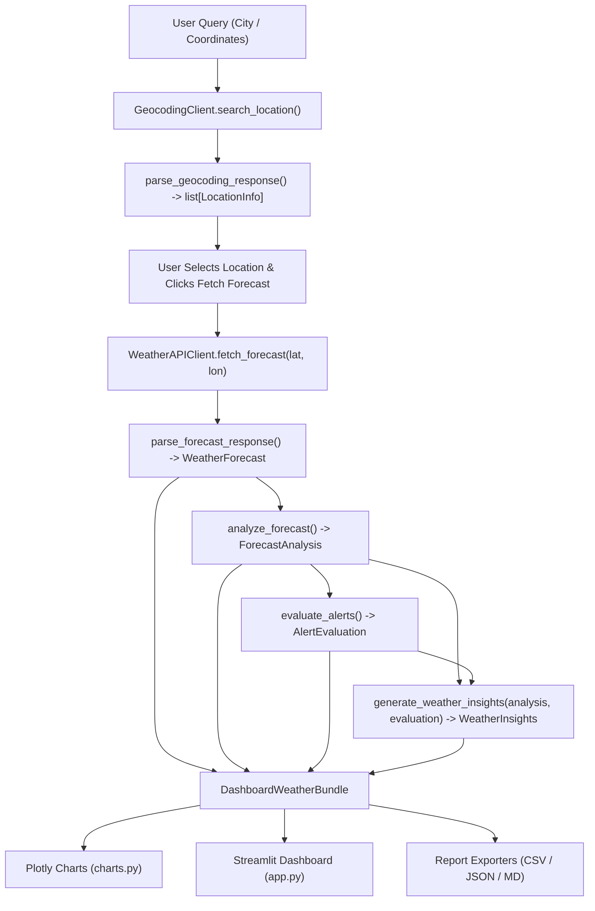

# Data Flow

**Author:** Akash Das  
**Status:** Implemented (Phases 3–11)  
**Last Updated:** 2026-11-27

## 1. End-to-End Pipeline Overview

## 2. Stage-by-Stage Data Movement
1. **Location Search (`api/geocoding.py` → `services/weather_service.py`):**
   - User enters a city name in `app.py` or `--city` in `scripts/generate_report.py`.
   - `GeocodingClient.search_location()` queries Open-Meteo's GeoNames-backed endpoint.
   - `parse_geocoding_response()` validates coordinates and required fields, returning `list[LocationInfo]`.
2. **Forecast Retrieval & Parsing (`api/client.py` → `services/weather_service.py`):**
   - Upon explicit fetch (`Fetch Forecast` button in `app.py` or CLI execution), `WeatherAPIClient.fetch_forecast()` fetches current, hourly, and daily JSON from Open-Meteo (`timezone=auto`, 7-day default horizon).
   - `parse_forecast_response()` validates required sections, coordinate bounds, array lengths, and ISO-8601 local timestamps, producing an immutable `WeatherForecast`.
3. **Descriptive Analysis (`analysis/forecast_analysis.py`):**
   - `analyze_forecast()` computes temperature, humidity, precipitation (`mm` separated from `%`), and wind summaries over non-`None` values and maps WMO weather codes via `describe_weather_code()`.
4. **Advisory Evaluation & Insights (`alerts/alert_engine.py` → `analysis/insights.py`):**
   - `evaluate_alerts()` checks `ForecastAnalysis` against `AlertThresholds` and produces deduplicated `WeatherAlert` items.
   - `generate_weather_insights()` translates `ForecastAnalysis` and `AlertEvaluation` into plain-language educational explanations.
5. **Orchestration & Output (`services/forecast_service.py`, `app.py`, `reporting/export.py`):**
   - `get_weather_dashboard_data()` bundles `WeatherForecast`, `ForecastAnalysis`, `AlertEvaluation`, and `WeatherInsights` into `DashboardWeatherBundle`.
   - `app.py` caches `DashboardWeatherBundle` in `st.session_state["weather_bundle"]`, renders metrics, tables, six Plotly charts, advisories, insights, and provides offline CSV/JSON/Markdown downloads.
   - `scripts/generate_report.py` writes safe, path-validated report files to `outputs/exports/`.
