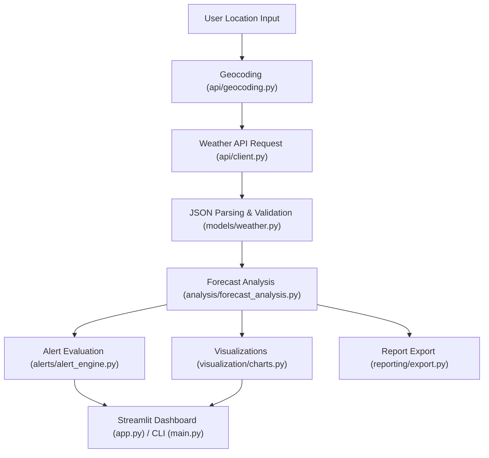

# Data Flow

**Author:** Akash Das  
**Status:** Planned (To be implemented across Phases 3–11)  
**Last Updated:** 2026-11-27

## 1. End-to-End Pipeline Overview

## 2. Stage-by-Stage Movement (Planned)
1. **Input:** User provides a city/location name via the Streamlit dashboard (`app.py`) or CLI (`main.py`).
2. **Geocoding & Fetching:** `api/geocoding.py` resolves the location to latitude/longitude, and `api/client.py` fetches weather JSON from Open-Meteo.
3. **Parsing & Validation:** Raw JSON is validated and mapped into structured models in `models/weather.py`.
4. **Analysis:** `analysis/forecast_analysis.py` processes current, hourly, and daily metrics (temperature trends, rainfall probability, humidity, wind) using Pandas.
5. **Alert Evaluation:** `alerts/alert_engine.py` checks processed metrics against configurable rules in `alerts/thresholds.py`.
6. **Output:** Results are rendered as interactive charts and advisories in `app.py`, optionally stored via `storage/database.py`, or exported to CSV/JSON via `reporting/export.py` into `outputs/exports/`.
