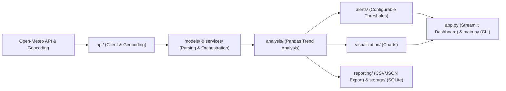

# System Architecture

**Author:** Akash Das  
**Status:** Phase 2 Scaffolded (Core modules created; implementation in Phases 3–11)  
**Last Updated:** 2026-11-27

## 1. High-Level Architecture
*(Planned end-to-end component interaction)*

## 2. Components & Responsibilities
| Package / File | Responsibility | Status |
| :--- | :--- | :--- |
| `src/weather_app/api/` | HTTP client and location geocoding | Configured (Phase 3); HTTP fetching in Phase 4 |
| `src/weather_app/core/` | Centralized configuration and custom exceptions | Configured (Phase 3) |
| `src/weather_app/models/` | Structured weather data models | Scaffolded (Phase 5) |
| `src/weather_app/services/` | Weather and forecast service orchestration | Scaffolded (Phase 4–6) |
| `src/weather_app/analysis/` | Forecast trend and metric analysis | Scaffolded (Phase 6) |
| `src/weather_app/alerts/` | Configurable alert rules and threshold evaluation | Scaffolded (Phase 7) |
| `src/weather_app/visualization/` | Forecast charts and plots | Scaffolded (Phase 8) |
| `src/weather_app/storage/` | Optional SQLite local persistence | Scaffolded (Phase 6+) |
| `src/weather_app/reporting/` | CSV and JSON report export | Scaffolded (Phase 11) |
| `src/weather_app/utils/` | Date/time and shared helper utilities | Scaffolded |
| `app.py` / `main.py` | Streamlit UI and CLI entry points | Scaffolded (Phase 9+) |

## 3. Technology Stack
- **Language:** Python 3.11.0 (isolated in `.venv/`) — *Verified in Phase 1*
- **Planned Libraries:** `requests` (HTTP), `pandas` (analysis), `matplotlib` / `plotly` (charts), `streamlit` (dashboard), `sqlite3` (storage), `pytest` (testing).

## 4. Architectural Decisions Log
| Date | Decision | Rationale | Status |
| :--- | :--- | :--- | :--- |
| 2026-11-26 | Dedicated `docs/` folder | Centralize all technical documentation | Active |
| 2026-11-27 | Local `.venv` with Python 3.11.0 | Isolate project dependencies at root | Active |
| 2026-11-27 | `src/weather_app/` modular layout | Separate API, parsing, analysis, alerts, UI, and tests | Active |
