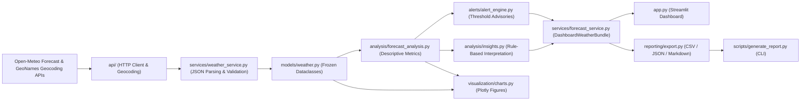

# System Architecture

**Author:** Akash Das  
**Status:** Phase 11 Implemented (Core Application, Dashboard, Insights, Reporting & Offline Tests Complete)  
**Last Updated:** 2026-11-27

## 1. Architectural Style
The application follows a **layered, modular Python architecture** under `src/weather_app/` using immutable (`frozen=True`) dataclasses for data transfer and strict separation between external I/O, domain parsing, deterministic analysis, advisory evaluation, visualization, reporting, and UI/CLI entry points.

## 2. Package & Module Responsibilities
| Package / File | Responsibility | Status |
| :--- | :--- | :--- |
| `src/weather_app/core/` | `APIConfig`, `get_api_config()`, and `WeatherAppError` exception hierarchy (`config.py`, `exceptions.py`) | Implemented (Phases 3, 11) |
| `src/weather_app/api/` | `WeatherAPIClient`, `GeocodingClient`, and shared timeout/error-translating `_http.py` | Implemented (Phases 3–4) |
| `src/weather_app/models/` | Immutable weather and location dataclasses (`LocationInfo`, `ForecastMetadata`, `CurrentWeather`, `HourlyForecast`, `DailyForecast`, `WeatherForecast`) | Implemented (Phase 5) |
| `src/weather_app/services/` | `parse_forecast_response()` & `parse_geocoding_response()` (`weather_service.py`); `search_locations()`, `get_weather_dashboard_data()`, `DashboardWeatherBundle` (`forecast_service.py`) | Implemented (Phases 5, 9, 10) |
| `src/weather_app/analysis/` | Descriptive `analyze_forecast()` & WMO code mapping (`forecast_analysis.py`); deterministic `generate_weather_insights()` (`insights.py`) | Implemented (Phases 6, 10) |
| `src/weather_app/alerts/` | Configurable `AlertThresholds` (`thresholds.py`) and deduplicated `evaluate_alerts()` (`alert_engine.py`) | Implemented (Phase 7) |
| `src/weather_app/visualization/` | Six Streamlit-independent Plotly chart builders (`charts.py`) with Dark/Light theme support | Implemented (Phase 8 + Post-Completion) |
| `src/weather_app/ui/` | Centralized Dark/Light `ThemePalette` tokens and CSS builder (`theme.py`) | Implemented (Post-Completion) |
| `src/weather_app/reporting/` | CSV (`utf-8-sig`), JSON, and Markdown exporters + path-safe file writer (`export.py`) | Implemented (Phase 11) |
| `src/weather_app/utils/` | Naive local ISO-8601 `parse_iso_datetime()` & `parse_iso_date()` (`date_time.py`) | Implemented (Phase 5) |
| `src/weather_app/storage/` | SQLite persistence scaffold (`database.py`) | Scaffolded (Optional/Future) |
| `app.py` | Interactive Streamlit dashboard with explicit fetch state management and download controls | Implemented (Phases 9–11) |
| `scripts/generate_report.py` | Standalone CLI for generating CSV, JSON, and Markdown reports | Implemented (Phase 11) |

## 3. Technology Stack
- **Language:** Python 3.11.0 (isolated in `.venv/`)
- **HTTP Client:** `requests>=2.31.0`
- **Visualization:** `plotly>=5.18.0`
- **Dashboard UI:** `streamlit>=1.32.0`
- **Testing:** `pytest>=8.0.0` (offline unit, `AppTest`, and CLI tests)

## 4. Key Architectural Principles
1. **No Silent Zero Substitution:** Missing (`None`) measurements are excluded from averages/sums, skipped in alert evaluation, rendered as gaps in Plotly, written as empty cells in CSV, serialized as `null` in JSON, and displayed as `Unavailable` in UI/Markdown.
2. **Naive Local Time Preservation:** Open-Meteo timestamps resolved with `timezone=auto` are preserved as naive local `datetime`/`date` values without UTC conversion.
3. **Explicit State Management:** `app.py` separates location search, location selection, and explicit **Fetch Forecast** execution in `st.session_state` so widget reruns and report downloads never trigger unintended API calls.
4. **Educational Boundary:** Alert advisories and insights are deterministic, rule-based educational summaries — not ML predictions or official meteorological warnings.
